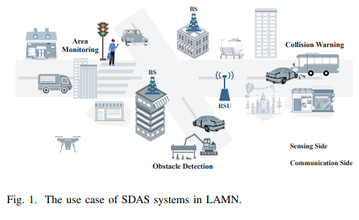
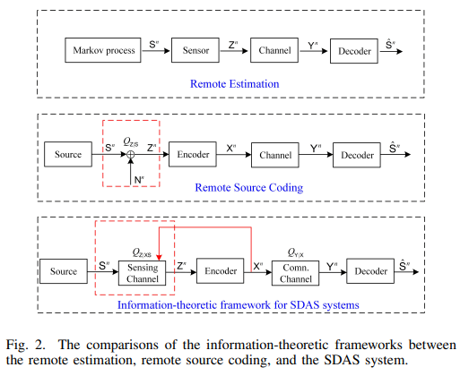
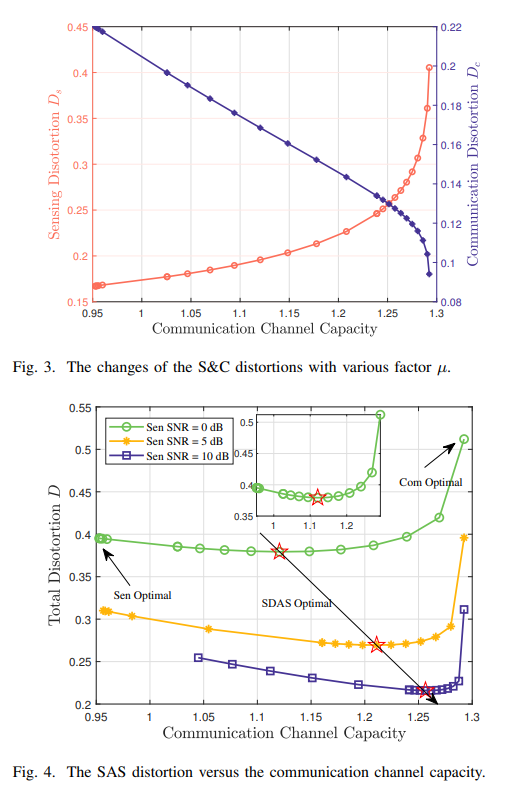
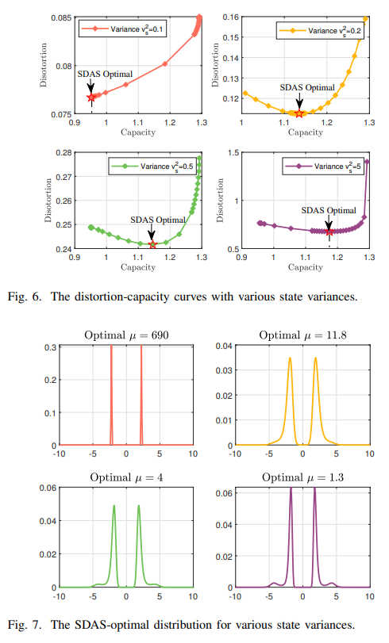
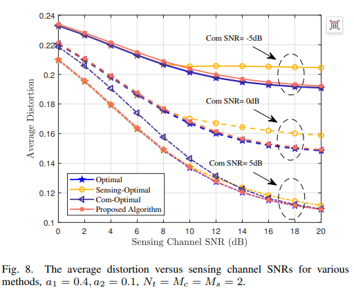
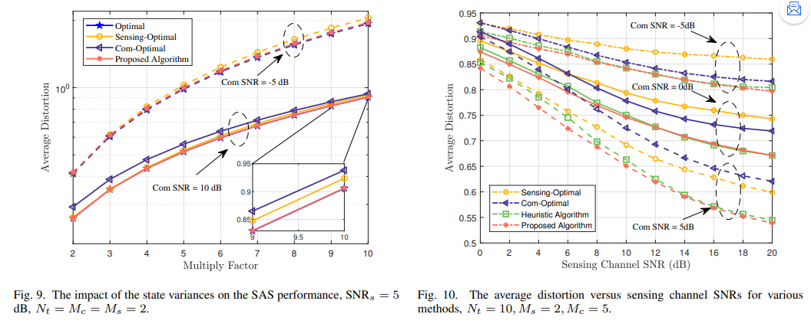
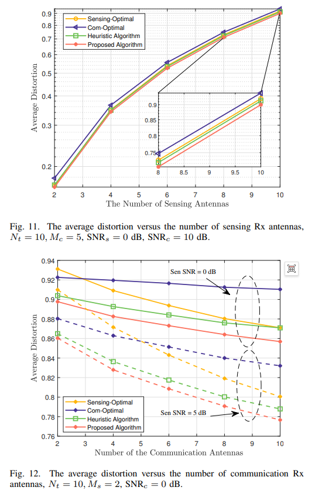

# Low-altitude Synthetic Aperture Radar (SAR) Integrated Breakthrough: Theory of Sensor Data Synchronous Acquisition and Sharing, along with Optimal Waveform Design [with MATLAB Code]

Low-altitude Synergistic Integration: Theory and Optimal Waveform Design for Perception Data Synchronous Collection and Sharing
As the low-altitude economy ascends to a national strategy, synergistic integration (ISAC) is becoming the core technology foundation of low-altitude wireless networks — drones serving as both airborne communication base stations and mobile perception platforms. In scenarios such as inspections, environmental monitoring, and emergency rescue, drones often need to perceive target states while simultaneously transmitting collected perception data back to ground users in real time.
When the same ISAC signal simultaneously undertakes dual tasks of "current target perception" and "historical data transmission," the perception and communication are deeply coupled through the emission of signals. Traditional optimization methods for separate indicators and remote estimation theories fail.
1. SDAS: A New Paradigm for Perception-Communication Coupling in Low Altitude Scenarios
In traditional ISAC research, perception and communication are often treated as "operating independently": perception is measured by SINR and Cramer-Rao bounds, while communication is measured by reachable rates. Finally, these are combined or optimized individually. However, this approach fails to address the most fundamental question: what accuracy does the ground user ultimately receive in perception data?
SDAS (Simultaneous Sensing Data Acquisition and Sharing) is a new paradigm proposed to address this issue: the system's sole core performance metric is the end-to-end distortion between the recovered target state and the actual state at the user side.
Unlike traditional solutions, which assume that perception observations and communication inputs are independent and satisfy the Markov chain assumption; SDAS involves direct determination of perception observations by ISAC emission signals, creating a deep coupling between them, making the traditional assumption no longer valid.
Unlike relay systems, which only forward communication signals without performing active perception; SDAS nodes function as both perception sources and communication relays, sharing the same emission signal.
Unlike traditional ISAC, which is "two functions realized simultaneously by the same signal," but with separate performance metrics; SDAS is "two processes jointly determining the same end-to-end distortion," necessitating end-to-end joint optimization.
In simple terms, SDAS involves a drone using a single signal to "detect" the current target and simultaneously transmitting the results of its previous "detection" back, ultimately aiming for the highest overall precision in the perception results received by the ground.
Theoretical foundation: The modified source-channel separation theorem, which is proposed as the first core contribution of the team, establishes a performance reachability criterion for an optimal system based on information theory.
The premise of the theorem: The condition of separable distortion applies to scenarios where the total distortion can be separated into perceptual and communication distortions: the total system distortion equals the sum of perceptual and communication distortions, i.e.,.
The paper rigorously proves that the most commonly used mean square error (MSE) in engineering, when using the MMSE optimal estimator, naturally satisfies this separable condition. This means that this theorem can directly cover the vast majority of parameter estimation scenarios involving perception, demonstrating strong engineering applicability.
The core conclusion is that under separable distortion measurement, the necessary and sufficient condition for the total distortion of an SDAS system to be achievable is: the rate distortion function of the source rate distortion function ≤ the channel capacity with perceptual constraints.
This physical meaning is very intuitive: the perception end must compress the estimated values to the minimum required code rate to achieve the specified distortion, not exceeding the maximum code rate provided by the communication channel when meeting the perceptual accuracy requirements and power budget constraints. As long as this condition is met, the corresponding total distortion can be achieved through coding schemes.
The team also completed rigorous coding theory proofs from both the counterfactual and reachability directions: the counterfactual argument demonstrates that any reachable scheme must satisfy this condition, while reachability is demonstrated through random coding that ensures the existence of corresponding coding schemes when the condition is met, solidifying the theoretical foundation of the theorem.
The greatest value of this theorem is that it decomposes the highly coupled SDAS problem into two classic information theory problems: "channel capacity with perceptual constraints" and "rate-distortion function for perceptual sources", providing a standardized theoretical basis for subsequent signal and waveform design. The next step is to establish a theoretical framework for solving the optimal input distribution using the two-step BA algorithm, which then asks: what kind of channel input distribution can minimize the total end-to-end distortion in SDAS?
This is a typical functional optimization problem, which is difficult to obtain closed-form solutions. The team proposed a two-step optimal search algorithm based on the classical Blahut-Arimoto (BA) algorithm for numerical solution.
The algorithm logic is divided into two layers: the outer layer and the inner layer. The optimal solution is solved by "dividing the problem + traversing weights".
1  
Subproblem 1: Maximizing Capacity with Perception-based Constraints
2  
Sub-question 2: Probability distribution of perceptual estimation values based on the input distribution obtained in the first step. Then solve the rate-distortion curve of this source using the BA algorithm, and substitute it into the current channel capacity to obtain the minimum communication distortion that can be achieved.
3  
The outer loop iterates through a series of different perception-communication weight factors to calculate the total distortion for each group, and the distribution corresponding to the minimum value is the optimal channel input for SDAS.
The numerical results of the compromised rules revealed by simulations clearly show the relationship between perceptual and communication performance:
Communication Optimal Point: When there are no perceptual constraints, the input follows a Gaussian distribution, achieving maximum channel capacity, but with higher perceptual distortion.
Perceptual Optimum: Under strong perceptual weight, the input presents a binary pulse amplitude modulation form, with the highest perceptual precision but limited communication capacity.
SDAS Optimal Point: The distribution of the product lies between the two, with a unique optimal balance point that minimizes total distortion.
The prior variance of the target also significantly affects the optimal strategy: The more deterministic (the smaller the variance), the more the optimal solution leans towards perceptual optimization; the higher the uncertainty in the prior (the larger the variance), the more it requires to enhance communication capacity to transmit more perceptual information.
MIMO Engineering Scenario: The scalar channel distribution optimization algorithm for SCA waveforms provides theoretical limits, but in practical engineering MIMO systems generally adopt Gaussian signaling. The team further proposed an SCA-based covariance matrix optimization algorithm for MIMO SDAS systems.
Problem Modeling: For the estimation scenario of MIMO target response matrices, under Gaussian assumptions, the team derived three core closed-form expressions:
Perceptual Distortion: Under MMSE estimation, the quantitative relationship between the perceptual MSE and the emission covariance matrix;
Rate-Distortion Function: Perceptual estimates as Gaussian sources, corresponding rate-distortion function;
Channel Capacity: The formula for MIMO Gaussian channel capacity.
Finally, waveform design is transformed into a constrained optimization problem: In the condition of transmit power constraints and MSST, optimize the emission covariance matrix to minimize end-to-end total distortion.
SCA Iterative Solving: Due to the presence of non-convex logarithmic determinant terms in the problem, the team adopted SCA technology for convex relaxation: perform first-order Taylor expansion on non-convex terms in each iteration, transform the original problem into a standard convex optimization problem, call convex optimization tools to solve and update the iteration points, repeatedly iterating until convergence.
Performance Verification: Simulation results fully verify the superiority of the algorithm:
Small scale scenario (2 transmitters, 2 receivers): The algorithm's performance is almost identical to the global exhaustive optimal solution, verifying its optimality;
High dimension scenario (10 transmitters, 5 receivers): The algorithm significantly outperforms pure perceptual optimal, pure communication optimal, and traditional heuristic weighted algorithms, with significant performance gains.
Affected by the number of antennas: an increase in the number of sensing receive antennas linearly enhances the dimensionality of the estimated parameters, leading to an overall increase in distortion; an increase in the number of communication receive antennas enhances channel capacity, thereby reducing overall distortion.
Summary and Outlook: This work represents a rare "from information theory foundation to engineering waveform design" comprehensive research in the field of SDAS. The three core contributions are progressively layered:
1. 
Theoretical Foundation: Proposed a revised separation theorem for source and channel, which is the first rigorous proof of the performance reachability condition for SDAS systems, filling the information theory gap in this scenario;
2. 
Algorithm Breakthrough: Introduces a two-step BA search algorithm to solve the optimal input distribution under scalar channels, revealing the compromise evolution law of the optimal distribution across senses;
3. 
Engineering Landing: For MIMO Gaussian signaling, proposes an SCA covariance optimization algorithm, providing a directly reusable solution for practical system design.
As the low-altitude economy accelerates, the "side perception, side feedback" working mode of SDAS will become more common. This theoretical framework and design method will also provide important theoretical support for ISAC system development in scenarios such as low-altitude inspection, smart agriculture, and emergency rescue.

## Images

<!-- PAYMENT_BLOCK -->

## Get this dataset

- Payment link (Stripe): [Buy now](https://buy.stripe.com/3cs8yP7sY87d0vu9AB)
- Payment QR code: 

<!-- /PAYMENT_BLOCK -->
